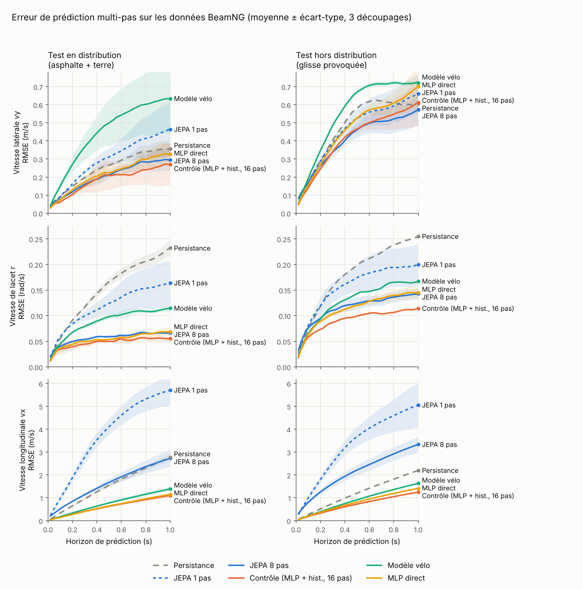
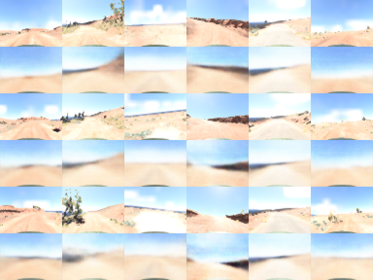

# rally-JEPA

World models of car dynamics, learned from simulated rally driving in
[BeamNG.tech](https://beamng.tech/), and evaluated against simple physical and
learned baselines.

The question behind the project: **does predicting in a learned latent space
(a JEPA-style world model) help predict how a car will move, compared with
predicting the physical state directly, or predicting future camera pixels?**

Short answer, on this data: **not measurably.** The experiments below show what
actually mattered, and why the camera-based models could not have succeeded on
speed.

> Personal research project, built outside coursework. Code comments are in French.

---

## Main findings

1. **Multi-step training is the decisive factor, not the latent space.**
   A JEPA trained to predict one step ahead drifts badly over a 1 s horizon.
   Training it on 8-step latent rollouts brings it level with the best models.
   But a direct predictor given the *same* 0.2 s history and the *same*
   multi-step training (horizon chosen on the same validation split) does as
   well or better on every quantity. The gain came from how the models were
   trained, not from the latent space.
2. **A linear-tire bicycle model, identified on the data, is the weakest model
   for lateral velocity**, and every learned model degrades on lateral velocity
   when tested on provoked slides it never saw during training.
3. **Camera-based world models (JEPA vs. pixel reconstruction) learned almost
   nothing about the car's speed** (linear-probe R² ≈ 0). A supervised upper
   bound shows why: even a network trained *directly* to predict speed cannot
   recover it from 64×64 frames at 10 Hz. For speed, the bottleneck is the
   data, not the self-supervised objective. Yaw rate is visible in the images
   (supervised R² 0.74), and both self-supervised models capture part of it,
   but only non-linearly, with pixel reconstruction slightly ahead of the JEPA.

---

## Data

Collected with BeamNGpy 1.36 on BeamNG.tech 0.39 (academic license), with the
simulator's AI driver. Vehicle state in the car's body frame at 50 Hz:
longitudinal speed `vx`, lateral speed `vy`, yaw rate `r`, plus steering,
throttle and brake.

| Set | Map | Driving | Runs | Role |
|---|---|---|---|---|
| Asphalt | `west_coast_usa` | AI with a random speed cap | 30 × 60 s | normal driving |
| Dirt | `utah` | AI with a random speed cap | 188 × 15 s | normal driving |
| Provoked slides | `utah` | **imposed** speed, high aggression | 88 + 86 × 20 s | out-of-distribution test |
| Camera | `utah` | 50 % normal / 50 % imposed speed, 64×64 dashcam at 10 Hz | 446 × 20 s | camera experiments |

The raw data (several hundred MB) is **not included**, because of its size and the
simulator license. The collection scripts are in `data/`.

Data-quality checks and pitfalls found along the way:
- **Low-speed artefact.** Dirt first looked much more "slidy" than asphalt.
  Split by speed, most of the gap came from slow manoeuvres right after each
  spawn. Hence: the first 5 s of every run are dropped, and only `vx > 5 m/s`
  is used.
- **Twin runs.** The two provoked-slide nights reused the same random seed:
  run *k* of both nights shares its start point and parameters, and its first
  seconds are nearly identical. Each pair is treated as a single group in every
  split.
- **Accelerometer axes.** In the logged BeamNG electrics, `accXSmooth` is the
  *lateral* acceleration (correlation 0.97 with `vx·r`) and `accYSmooth` the
  longitudinal one with opposite sign. The `acc_x`/`acc_y` columns are named
  after the sensor, not the physical axis.
- **Simulator stall.** After ~88 runs, the AI driver stopped driving, even after
  a scenario reload. The camera collection fully relaunches BeamNG every
  80 runs, and whenever the AI goes idle.

---

## Experiment 1: state-based world models

Train on 80 % of the asphalt + dirt groups; test on the remaining 20 %
(*in distribution*) and on all provoked slides (*out of distribution*).
Rollouts start from a real state and use the true future actions. Mean RMSE
over 3 splits; standard deviation in parentheses.

**Error at a 1 s horizon**

| Model | vy in-dist. | vy slides | r in-dist. | r slides | vx in-dist. | vx slides |
|---|---|---|---|---|---|---|
| Persistence (state frozen) | 0.355 | 0.606 | 0.232 | 0.255 | 2.77 | 2.20 |
| Bicycle model (identified, per surface) | 0.634 | 0.722 | 0.115 | 0.167 | 1.39 | 1.63 |
| Direct MLP, 1-step training | 0.326 | 0.702 | 0.068 | 0.145 | 1.15 | 1.41 |
| JEPA, 1-step training | 0.464 | 0.660 | 0.164 | 0.200 | 5.71 | 5.06 |
| JEPA, 8-step rollout training | 0.295 | 0.573 | 0.066 | 0.143 | 2.73 | 3.33 |
| **Control:** direct MLP + same history, 16-step rollout training | **0.270** | 0.613 | **0.055** | **0.114** | **1.10** | **1.25** |

Units: m/s for `vx` and `vy`, rad/s for `r`. Full curves:
`results/figures/eval_jepa.png`.



How to read it:
- Multi-step training transforms the JEPA (yaw-rate error 0.164 → 0.066), but
  the control does at least as well: clearly better on yaw rate and
  longitudinal speed, and a tie on lateral speed (the differences are smaller
  than the spread between splits).
- The rollout horizon K was chosen on a **validation split carved out of the
  training groups**, separately for each model family (JEPA: K = 8 among
  {1, 4, 8, 16}). The test sets were only used for the final numbers.
- The JEPA latent also keeps less information than its input: a linear probe
  recovers the sideslip angle with R² 0.85 (8-step JEPA), against 0.90 from
  the raw state.
- The bicycle model uses a linear tire and is identified by least squares, with
  one coefficient set per surface. All four coefficient signs are physically
  consistent, and the steering coefficient is about half as large on dirt as on
  asphalt (lower grip).

Disclosure: two read-out choices for the JEPA (decoding in the target-encoder
space, and an "anchored" read-out that decodes the predicted change from the
known initial state) were made while looking at the in-distribution test set.
The slide test set was never used for any choice.

## Experiment 2: camera-based world models (JEPA vs. pixel reconstruction)

Input: the last 3 dashcam frames (0.2 s, hood cropped, 48×64) plus driver
actions. Both models share the same CNN encoder, predictor and 8-step rollout
training. The only difference is the loss:
- **JEPA**: predict the next latent of an EMA target encoder, with VICReg
  against collapse;
- **Reconstruction**: a decoder reconstructs the current and each predicted
  future frame (pixel MSE).

Train on 80 % of the normal-driving camera runs, test on the remaining 20 % and
on all imposed-speed runs. 10 seeds, GTX 1650.

**Linear probe on frozen latents, R²**

| | vx | vy | r | sideslip |
|---|---|---|---|---|
| JEPA, in distribution | 0.01 | 0.01 | 0.15 | 0.01 |
| Reconstruction, in distribution | 0.06 | 0.00 | 0.13 | 0.00 |
| JEPA, slides | 0.06 | 0.00 | 0.13 | 0.00 |
| Reconstruction, slides | 0.11 | 0.00 | 0.14 | 0.00 |

Neither model collapsed (effective rank ≈ 50/64 for the JEPA, ≈ 25/64 for
reconstruction), yet their embeddings hold almost no linearly decodable
information about speed. As a result, their rollouts cannot be compared in a
meaningful way: the JEPA's latent rollout stays stable but predicts roughly the
mean, and the reconstruction model's predicted latents drift out of the range
the probe was fitted on.

Reconstruction examples (real frame above, model below; rows: t, t + 0.5 s,
t + 1 s): the model keeps the horizon and the road layout and blurs everything
else, as expected from a pixel-MSE objective.



## Experiment 3: why? A supervised upper bound

Same data and splits, 3 seeds. R² in distribution / on slides:

| | vx | vy | r |
|---|---|---|---|
| **Supervised CNN, 3 frames** (same encoder, trained directly on the targets) | −0.04 / 0.20 | 0.14 / 0.09 | **0.74** / 0.49 |
| Supervised CNN, 1 frame | −0.13 / 0.12 | 0.14 / 0.08 | 0.68 / 0.42 |
| Reconstruction, MLP probe | −0.22 / 0.04 | −0.03 / 0.04 | 0.50 / 0.21 |
| JEPA, MLP probe | −0.13 / −0.04 | −0.13 / −0.02 | 0.43 / 0.20 |
| Linear probes (both models) | ≈ 0 / ≈ 0.1 | ≈ 0 | ≈ 0.15 |

- **Speed is not recoverable from these frames**, even with direct supervision.
  The supervised network fits its training runs but does not generalise to new
  ones. At 64×64 and 10 Hz on fairly uniform dirt, ground motion is barely
  visible.
- **Yaw rate is visible**, mostly from a single frame (1 frame ≈ 3 frames):
  probably from the road layout rather than from motion between frames.
- The self-supervised latents carry part of the yaw information, **only
  non-linearly**, with reconstruction slightly ahead of the JEPA. On this
  setup, nothing supports the claim that latent prediction beats pixel
  prediction.

---

## Limitations

One simulator, one car (`etk800`, with ESC and traction control active), two
maps, an AI driver, horizons of at most 1 s, small CPU/GTX-1650-scale models,
3 to 10 seeds. The camera experiments are limited by low resolution and frame
rate: testing JEPA vs. pixel prediction properly would need richer motion
information (higher resolution or frame rate, optical flow), i.e. a new
collection.

## Repository layout

```
config.py                 paths and shared settings
data/
  test_beamng.py          sensor inspection (first contact with BeamNGpy)
  collect_beamng.py       asphalt collection (+ shared body-frame helpers)
  collect_dirt.py         dirt collection, several spawn points
  collect_slide.py        provoked slides (imposed speed), idle-AI recovery
  collect_cam.py          camera collection, periodic simulator relaunch
  make_dataset.py         synthetic bicycle-model data (sanity check)
src/
  real_data.py            loading, regimes, grouped splits (twin runs merged)
  bicycle.py              identified linear bicycle model
  eval_state.py           state-space multi-step evaluation, baselines
  jepa_real.py            state-based JEPA, rollout training, validation-based K, controls
  plot_eval.py            figures
  jepa_cam.py             camera world models: JEPA vs. reconstruction
  diag_cam.py             supervised upper bound + MLP probes
  dataset.py, model.py, train_jepa.py, baselines.py, probe.py
                          first prototype on synthetic data (kept for reference)
results/                  result tables (CSV), figures, run logs
lancer_nuit*.bat          Windows launchers for unattended overnight collection
```

## Reproducing

```bash
pip install -r requirements.txt

# state-based experiments (CPU, about 1 h); needs the four data/raw_runs*.csv files
python src/eval_state.py
python src/jepa_real.py --k 8 --control
python src/plot_eval.py --jepa

# camera experiments (GPU recommended); needs data/raw_runs_cam.csv and data/frames_cam/
python -W ignore src/jepa_cam.py --seeds 10
python -W ignore src/diag_cam.py --seeds 3
```

Data collection requires BeamNG.tech 0.39 and BeamNGpy 1.36. Set `HOME` in
`data/collect_beamng.py` to your BeamNG.tech folder.

## References

- Y. LeCun, *A Path Towards Autonomous Machine Intelligence*, 2022.
- M. Assran et al., *V-JEPA 2: Self-Supervised Video Models Enable Understanding, Prediction and Planning*, arXiv:2506.09985, 2025.
- A. Bardes, J. Ponce, Y. LeCun, *VICReg: Variance-Invariance-Covariance Regularization for Self-Supervised Learning*, ICLR 2022.
- D. Ha, J. Schmidhuber, *World Models*, 2018.
